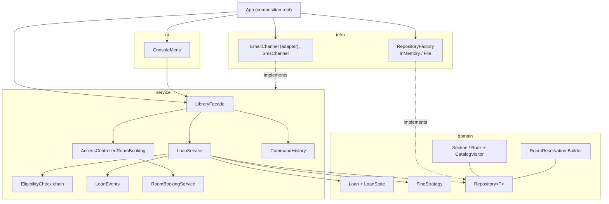

# Campus Library and Room Booking

A pattern-driven information system for a university library (Capstone, *Application Design Based on Patterns*, topic 1).

## Domain

The library has a **catalogue** organised as a tree of sections (Science → Computing → books).
**Members** are students or staff. A member can **reserve** a book and pick it up later, or **borrow** it at the desk.
Each loan moves through a lifecycle: *Reserved → Borrowed → (Overdue) → Returned*, or *Reserved → Cancelled*.
Before a loan is opened the system checks that the member is active, has no large unpaid fines, is under the loan limit, and that the book is free.
A daily **overdue scan** flags late loans and sends **overdue notices** by e-mail and SMS.
On return, a **fine** is charged according to the reader type (students: 0.50/day, cap 20; staff: 0.25/day after 2 grace days, cap 10).
Members can also **book study rooms** (08:00–22:00, max 3 hours, no double booking). Some rooms are **staff-only**. Room bookings and cancellations can be **undone**.

## How to run

Requirements: Java 17+, Maven 3.9+.

```bash
mvn verify                                        # tests + ArchUnit rules + 60% coverage gate
mvn -q compile exec:java                          # run with the in-memory store
mvn -q compile exec:java -Dexec.args=--store=file # run with the file store (./data)
```

Or `mvn package` and then `java -jar target/campus-library.jar [--store=file]`.
In VS Code press **F5** and pick *App (in-memory store)* or *App (file store)*.

### Demo script (main use case + extension point)

| Step | Menu input | What it shows |
|------|-----------|---------------|
| 1 | `1` | Catalogue tree (Composite + Visitor) |
| 2 | `6`, `M-1`, `B-1` | Borrow passes the eligibility chain |
| 3 | `6`, `M-2`, `B-1` | Refused: book already on loan (Chain) |
| 4 | `18`, `20` then `11` | Advance 20 days, overdue scan → e-mail **and** SMS notice (Observer, extension point) |
| 5 | `9`, `L-1000` | Return → fine 3.00 (State + Strategy) |
| 6 | `14`, `M-1`, `RM-3`, … | Student refused staff-only room (Proxy) |
| 7 | `14`, `M-1`, `RM-1`, ``, `10`, `12`, `study` | Room booked (Builder + Command) |
| 8 | `17` | Undo the booking (Command) |
| 9 | `20`, `csv`, path | Import books from CSV (Template Method) |

Demo data: members `M-1`, `M-2` (students), `M-3` (staff); books `B-1`…`B-6`; rooms `RM-1`, `RM-2`, `RM-3` (staff only).

## Architecture

Four layers. Dependencies point inward; the rules are enforced by `ArchitectureTest` (ArchUnit).
`App` is the only composition root: it creates every concrete class and wires them together.



| Package | Contents | May depend on |
|---------|----------|---------------|
| `domain` | Entities and domain rules, `Repository` interface | nothing else |
| `service` | Use cases, `NotificationChannel` port | domain |
| `infra` | Repository implementations, notification channels | service, domain |
| `ui` | Console menu | service, domain (for display) |
| root | `App` — composition root | everything |

## Patterns

13 patterns (2 creational, 4 structural, 7 behavioral). Details, classes and tests: [docs/PATTERN_REGISTER.md](docs/PATTERN_REGISTER.md). Decisions: [docs/adr](docs/adr).

## Extension points (Open/Closed)

| To add… | Write a new class implementing | Then register it in |
|---------|-------------------------------|---------------------|
| A notification channel (Telegram, push) | `service.NotificationChannel` | `App.build` (channel list) |
| A fine rule (amnesty, per-book-type) | `domain.fine.FineStrategy` | `App.build` (`FinePolicy` map) |
| A catalogue report (CSV export, statistics) | `domain.catalog.CatalogVisitor<R>` | call `catalog.report(new …)` |
| A loan eligibility rule | extend `service.eligibility.EligibilityCheck` | `App.build` (chain) |
| An undoable room action | `service.command.Command` | `LibraryFacade` |
| An import format (JSON, MARC) | extend `service.importing.CatalogImporter` | `App.build` (importer list) |
| A mail provider | adapter implementing `service.NotificationChannel` | `App.build` |
| A storage technology (SQLite) | `infra.persistence.RepositoryFactory` | `App.main` |

`SmsChannel` and `AuthorIndexReport` were added this way, as new classes only.

## Persistence

`Repository<T>` (domain) has two implementations: `InMemoryRepository` and `FileRepository` (Java serialization, one file per aggregate in `./data`, atomic writes).
The family is chosen once in `App.main` via `RepositoryFactory`; services never change. `LoanServiceTest.sameServicesWorkUnchangedOnFileRepositories` proves it.

## Libraries

| Library | Scope | Why |
|---------|-------|-----|
| JUnit 5 | test | unit tests |
| ArchUnit | test | layer rules |
| JaCoCo (plugin) | build | coverage gate ≥ 60% |
| exec-maven-plugin | build | `mvn exec:java` |

No library implements a pattern for us.

## Team

| Student | GitHub handle | Reflection |
|---------|---------------|------------|
| _name_ | _@handle_ | `docs/reflection-<handle>.md` |
